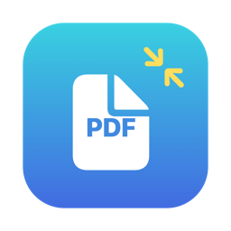
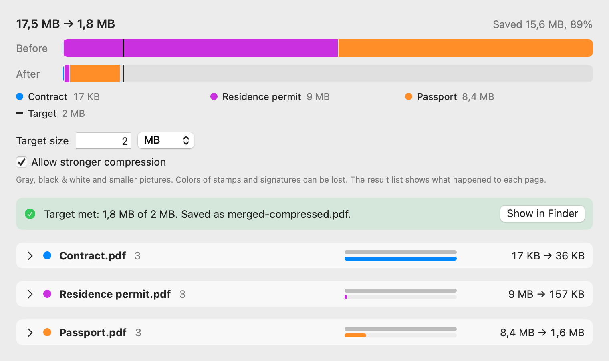

<p align="center"></p>

# PDF to Size

**Join your PDFs and shrink them to the exact size a website asks for.**

You drop one or more PDF files, type a size (for example 1 MB), and press one button. PDF to Size joins the
files, looks at every page on its own, and finds the lightest way to keep each page readable. The result is
a new file under your limit. Your originals are never changed. Everything happens on your Mac: your documents are never uploaded anywhere.

It is a Mac app and a command-line tool. Both are free and open source.

<p align="center">
  <picture>
    <source media="(prefers-color-scheme: dark)" srcset="docs/images/screenshot-dark.png">
    
  </picture>
</p>
<p align="center"><sub>Made-up demo files. The window with real files looks the same.</sub></p>

---

## Why I built it

Offices, embassies and online forms ask for "a PDF up to 1 MB" (or 2, or 5). My papers are scans: a
contract, a passport, a residence permit. A phone or a scanner gives 3 to 5 MB per page. Thirteen pages of one
contract were 12.7 MB.

I tried several tools. No single one got me to the limit, so I chained them:
one tool for the first pass, another for the pages that were still too big, and so on. After each step I
checked the size and checked that the text could still be read. Then I did it again.

### The options I looked at

| Option | Why it did not work for me |
|---|---|
| PDF Optim | It compresses well, but it is paid. It also treats the whole document with one setting, so it is hard to hit an exact size automatically. I had to optimize each document on its own and join the results by hand. |
| Lightweight PDF | It did not compress strongly enough. |
| Online services | Full of ads, and I do not want to upload personal documents (a passport, a contract) to someone else's server. |
| Using several of them one after another | It worked in the end, but it is slow manual work, and quality is a guess at every step. |

What I needed was different: **I give the size, the tool finds how to reach it, and tells me what it did to every page.**

### My way

- Treat a page as a unit. A page of plain text, a colored passport photo, and a gray stamp need different treatment.
- Try the gentle way first: smaller pictures, in steps of 20%, never below a readable size.
- Go further only with your permission: gray, or black and white for text pages.
- Never touch the original. Measure the real file, not an estimate. Show before and after.

PDF to Size is that workflow in one window. Other tools may suit you better. This one is about my way.

---

## What it does

- **Joins files.** Drop several PDFs; the order is the order in the list. You get one file.
- **Hits the size.** You set the target. It builds the real file, measures it, and adjusts up to five times.
- **Works page by page.** Pages that are already small stay as they were. Big scans get smaller pictures.
  The page that saves the most bytes for the least loss of quality is reduced first.
- **Asks before it goes hard.** If gentle compression is not enough, it tells you how far stronger compression
  would get (for example "3.4 MB safe, 1.7 MB stronger") and waits for your yes.
  Stronger means: gray instead of color, lower resolution, black and white for text pages.
- **Does not make things worse.** If the file already fits, or the result would be bigger, it writes nothing.
- **Shows what happened.** A Before bar and an After bar on the same scale, split by file. Open a file to see
  every page: what was done, and its size before and after.
- **Is fast.** Pages are processed in parallel. 17 scanned pages take about two seconds.

On my own papers (a 13-page contract, a passport, a residence permit; 14.8 MB in total) it reached
**996 KB** for a 1 MB limit. The contract pages became black and white, the passport stayed in color.

### What to know before you use it

- **Check the result by eye.** There is no automatic readability check yet. Open the file and look,
  especially after "stronger compression".
- **Gray and black and white lose color.** Blue ink, stamps and colored logos turn gray or black.
  A colored page (a passport, a certificate) is never changed to gray or black and white unless it is nearly colorless.
- **Pages are redrawn.** Text stays sharp, but links, bookmarks, form fields and digital signatures are not kept.
  A signed PDF will no longer be valid. Do not use it for files that must stay signed.
- **No text layer for scans.** A scan stays a picture; you cannot select or search its text. (OCR is planned, as an option.)
- **Password-protected files** are refused.
- **1 MB is 1,000,000 bytes**, the safe reading of a website limit.

---

## Install

Needs macOS 14 Sonoma or newer. Works on Apple silicon and Intel Macs.

### Easiest: one command

Open **Terminal** (press Cmd-Space, type `Terminal`, press Enter), paste this line, press Enter:

```bash
/bin/bash -c "$(curl -fsSL https://raw.githubusercontent.com/yanmasharski/PDFtoSize/main/install.sh)"
```

It downloads the latest release, checks it, puts `PDFtoSize.app` in Applications, and opens it.
No warning from macOS, because a file downloaded this way is not marked as "from the internet".
You can read the script first: [install.sh](install.sh). Run it again any time to update.

### Download by hand

1. Download `PDFtoSize.zip` from [Releases](../../releases) and unzip it.
2. Move `PDFtoSize.app` to Applications.
3. Open it. macOS will most likely refuse, see the next section.

### macOS says the app is "damaged", "unsigned", or "from an unidentified developer"

This is normal for apps outside the App Store that are not notarized by Apple. Notarization needs a paid
Apple Developer account ($99 a year). PDF to Size is free and open source, so it does not have one yet.
The app is signed in the "ad hoc" way: it is not changed after the build, but Apple has not checked it.
Browsers mark every download as "from the internet", and macOS blocks such apps at the first launch.
The message may say the app is damaged and should be moved to the Trash. **Do not delete it. It is not damaged.**

Pick one way:

1. **The one command above.** It also fixes an app you already downloaded: it replaces it with a clean copy.
2. **Allow it in System Settings** (macOS 15 and newer):
   1. Try to open the app once. Click **Done** (not "Move to Trash").
   2. Open System Settings → **Privacy & Security**, scroll down to **Security**.
   3. Click **Open Anyway** next to "PDFtoSize was blocked", then confirm with your password.
   On macOS 14 you can also right-click the app → **Open** → **Open**.
3. **Remove the mark in Terminal** (if the app is in Applications):

   ```bash
   xattr -dr com.apple.quarantine /Applications/PDFtoSize.app
   ```

If you do not trust a program from the internet, build it yourself from the source: see below.

### Build from source

Needs the Xcode command line tools (`xcode-select --install`).

```bash
./scripts/build-app.sh
open build/PDFtoSize.app
```

Command-line tool:

```bash
swift build -c release
.build/release/pdftosize --target 1MB contract.pdf passport.pdf
```

---

## Command line

```bash
pdftosize [--target 1MB] [--strong] file.pdf [more.pdf ...]
```

| Option | Meaning |
|---|---|
| `--target 1MB` | The size to reach. Accepts `MB`, `KB`, or a number of bytes. Default: 1 MB. |
| `--strong` | Allow stronger compression: gray, black and white, lower resolution. |

The result is saved next to the first file: `<name>-compressed.pdf` for one file, `merged-compressed.pdf` for
several. If the name exists, a number is added. The tool prints what it did to every page.

---

## For developers

```bash
swift test
./scripts/package-release.sh   # builds dist/PDFtoSize.zip and its .sha256 file for a release
swift scripts/make-icon.swift  # redraws Assets/AppIcon.icns
```

The window can be drawn to a PNG without a screen, for the screenshots above:

```bash
.build/release/PDFtoSizeApp --snapshot out.png --compress --strong --target 2 a.pdf b.pdf
```

How it works, in short:

1. Every page gets a ladder of ways to build it: as it was, pictures 20% smaller step by step (never above the
   scan's own size), and with consent gray and black and white. Only options that are really smaller stay.
2. Start with the best of each page. Step down the page that saves the most bytes per lost quality, until the sum fits.
3. Build the real file, measure it, correct the budget, repeat (at most five times).

Only Apple frameworks are used (PDFKit-level Core Graphics, ImageIO). No third-party code, so no AGPL
libraries such as Ghostscript or MuPDF.

## License

[MIT](LICENSE).

## Status

Early. I use it on my own Mac. Bug reports are welcome.

Planned: a check that text is still readable (OCR), an optional invisible text layer, choosing the level for
each page by hand, and previews of a page before and after.
